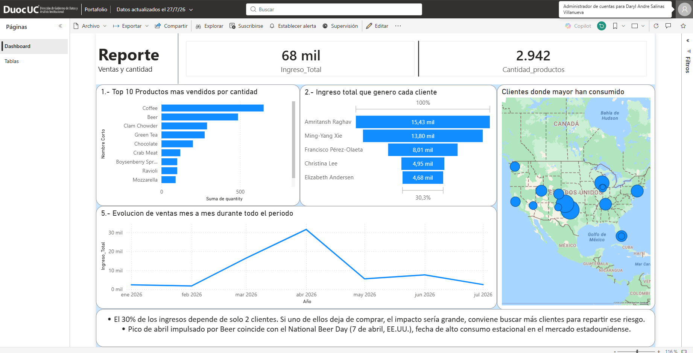
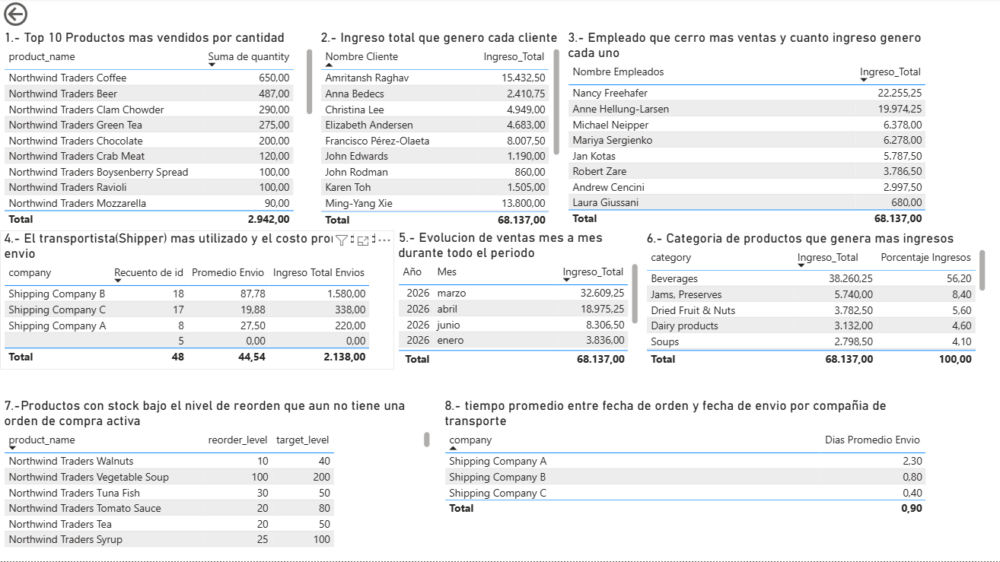

# 📊 Análisis de Ventas — Northwind Traders

Proyecto end-to-end de análisis de datos que va desde una base de datos MySQL hasta un dashboard interactivo en Power BI, con un módulo adicional de automatización en Python que genera y envía reportes por correo.

El objetivo fue simular el trabajo de un analista de datos dentro de una empresa de distribución de alimentos: entender el negocio a través de SQL, construir un dashboard ejecutivo y automatizar la entrega de reportes.

---

## 🧰 Stack utilizado

| Área | Herramientas |
|---|---|
| Base de datos | MySQL / MySQL Workbench |
| Análisis y consultas | SQL (joins, agregaciones, subconsultas, funciones de fecha) |
| Visualización | Power BI (DAX, tabla de Calendario, mapas) |
| Automatización | Python (`pandas`, `matplotlib`, `mysql-connector`, `reportlab`, `smtplib`) |

---

## 🗂️ Estructura del repositorio

```
├── Creacion_de_base_de_datos_Northwind.sql   # Script de creación del esquema (DDL)
├── Respaldo_1.sql                            # Dump de datos para restaurar la base
├── Visualizacion_de_datos_en_SQL.sql         # 8 consultas de negocio resueltas en SQL
├── Reporte_automatizado_correo_nuevo.py      # Automatización: genera PDF y lo envía por correo
├── Portafolio.pbix                           # Dashboard en Power BI
├── Dashboard.png / Tabla.png                 # Capturas del dashboard
├── grafico_productos.png                     # Gráficos generados por el script de Python
├── grafico_clientes.png
├── grafico_evolucion.png
└── reporte_northwind_*.pdf                   # Ejemplos de reportes automatizados generados
```

---

## ❓ Preguntas de negocio resueltas en SQL

El análisis parte de 8 preguntas de negocio, todas resueltas con SQL puro (joins, `GROUP BY`, subconsultas correlacionadas y funciones de fecha):

1. Top 10 productos más vendidos por cantidad
2. Ingreso total generado por cada cliente
3. Empleado que cerró más ventas y cuánto ingreso generó
4. Transportista (shipper) más utilizado y costo promedio de envío
5. Evolución de ventas mes a mes durante todo el período
6. Categoría de productos que genera más ingresos
7. Productos con stock bajo el nivel de reorden sin una orden de compra activa
8. Tiempo promedio entre fecha de pedido y fecha de envío, por transportista

📄 Consultas completas en [`Visualizacion_de_datos_en_SQL.sql`](./Visualizacion_de_datos_en_SQL.sql).

---

## 📈 Dashboard en Power BI

El dashboard traduce las consultas SQL en visualizaciones interactivas: KPIs generales, top de productos y clientes, mapa de distribución geográfica de clientes y evolución mensual de ingresos.





**Insights destacados:**
- ☕ *Coffee* y *Beer* concentran la mayor parte de las ventas por volumen, muy por delante del resto del top 10.
- ⚠️ El **30% del ingreso total depende de solo 2 clientes**, lo que representa un riesgo de concentración de cartera.
- 🔍 El pico de ingresos de marzo (88% del mes en un solo producto, Coffee) **no refleja una tendencia de demanda**: se investigó a nivel de pedido individual y se confirmó que responde a que los mismos 2 clientes de alto valor concentraron ahí sus compras grandes de Coffee. Es la misma señal de riesgo de concentración de clientes, vista mes a mes en vez de acumulada — no un patrón estacional de producto.

> 🧪 **Nota de metodología:** el primer patrón detectado en el dashboard (un pico mensual atribuible a un solo producto) se validó bajando el análisis a nivel de pedido individual en SQL, en vez de aceptar la explicación más obvia a nivel agregado. Esto evitó reportar una falsa tendencia estacional y permitió identificar la causa real: concentración de ingresos en pocos clientes.

---

## 🤖 Automatización con Python

`Reporte_automatizado_correo_nuevo.py` cierra el ciclo de análisis conectándose directamente a MySQL para generar, sin intervención manual, un reporte ejecutivo en PDF (KPIs, tablas y gráficos) y enviarlo por correo.

**Flujo:**
1. Se conecta a MySQL y ejecuta las consultas de negocio clave.
2. Genera gráficos con `matplotlib` (top productos, top clientes, evolución mensual).
3. Arma un PDF con `reportlab`, combinando tablas, gráficos e insights.
4. Envía el PDF por correo automáticamente vía `smtplib`.

📄 Ejemplos de salida: [`reporte_northwind_11-07-2026.pdf`](./reporte_northwind_11-07-2026.pdf)

> ⚙️ Para ejecutarlo en tu propio entorno, las credenciales de base de datos y de correo deben configurarse como variables de entorno — no deben quedar escritas en el código.

---

## ▶️ Cómo ejecutar el proyecto

1. Crear la base de datos ejecutando `Creacion_de_base_de_datos_Northwind.sql` en MySQL Workbench.
2. Restaurar los datos con `Respaldo_1.sql`.
3. Ejecutar las consultas de `Visualizacion_de_datos_en_SQL.sql` para explorar el análisis en SQL.
4. Abrir `Portafolio.pbix` en Power BI Desktop y conectar la fuente de datos a tu instancia local de MySQL (`127.0.0.1`).
5. (Opcional) Configurar variables de entorno y ejecutar `Reporte_automatizado_correo_nuevo.py` para generar y enviar el reporte en PDF.

---

## 👤 Autor

**Daryl Salinas**
Analista de datos en formación — SQL · Power BI · Python
[LinkedIn](#) · [GitHub](#)
